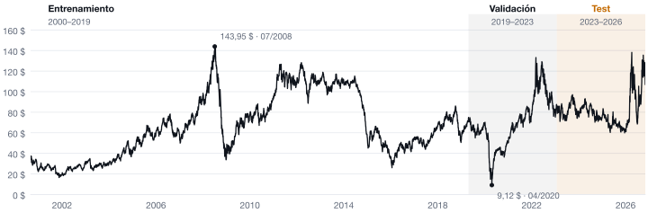
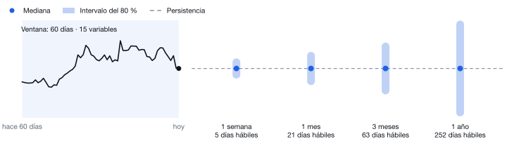
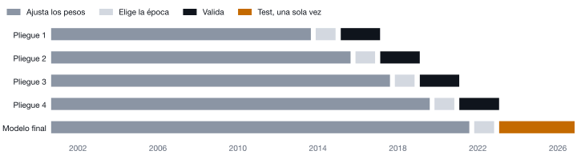
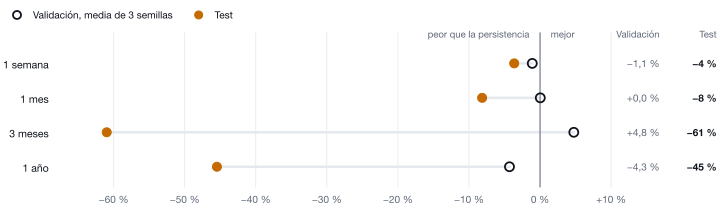
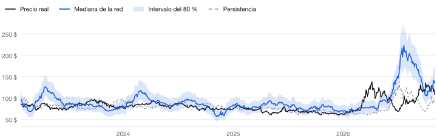

<div align="center">

# oil-rnn

**Predicción del precio del Brent con redes recurrentes, ejecutada en el navegador.**

[](https://alejandrobarreche.github.io/oil-rnn/)
[](docs/USAGE.md)
[](docs/DECISIONES.md)
[](docs/references.bib)

[](https://github.com/alejandrobarreche/oil-rnn/actions/workflows/ci.yml)

</div>

<picture>
  <source media="(prefers-color-scheme: dark)" srcset="docs/img/history-dark.svg">
  
</picture>

Una RNN simple, una LSTM y una GRU predicen el Brent a **1 semana, 1 mes, 3 meses y 1 año**. Cada una se compara con la referencia más simple: **el precio de hoy**, la persistencia. El modelo elegido se ejecuta en el navegador, sin servidor.

## Qué predice

<picture>
  <source media="(prefers-color-scheme: dark)" srcset="docs/img/forecast-dark.svg">
  
</picture>

La red lee los últimos 60 días de 15 variables de mercado y da, para cada horizonte, la mediana y un intervalo del 80 %. Hay un modelo por horizonte.

<sub>Esquema: el tamaño de los intervalos es ilustrativo.</sub>

## Cómo se valida

<picture>
  <source media="(prefers-color-scheme: dark)" srcset="docs/img/walk-forward-dark.svg">
  
</picture>

Cada pliegue entrena con todo lo anterior y valida los 2 años siguientes. Entre tramos quedan `h` días sin usar, para que ningún dato de entrenamiento mire al futuro. Test se usa una sola vez, al final.

## Resultado

<picture>
  <source media="(prefers-color-scheme: dark)" srcset="docs/img/skill-dark.svg">
  
</picture>

**Prometedor en validación, no se confirma en test.** En 2023–2026 ninguna red supera a la persistencia en ningún horizonte. Ninguna diferencia es significativa al 5 %: la red no la mejora, pero tampoco se puede afirmar que sea peor.

<picture>
  <source media="(prefers-color-scheme: dark)" srcset="docs/img/test-h63-dark.svg">
  
</picture>

<sub>3 meses (GRU) en test: acierta el signo del cambio el 60 % de los días, pero exagera los movimientos recientes.</sub>

## Inicio rápido

```bash
make setup
conda activate oil-rnn
make data
make prepare
make cv NAME=<nombre>
make train NAME=<nombre> CALIB=<run_id de make cv>
make web-dev
```

- **`make pending`**: lista los valores `PENDIENTE` de `configs/config.yaml`; los comandos que los usan se detienen.
- **Todos los comandos**: en la [guía de uso](docs/USAGE.md). `make help` los resume.

## Detalles técnicos

<details>
<summary><b>Selección de modelos</b>: rejilla y validación walk-forward</summary>

- **Rejilla**: 36 configuraciones (tamaño oculto 32–256, 1 o 2 capas, dropout 0 o 0,3, tasa de aprendizaje 1e‑4 a 1e‑3) para las tres celdas y los cuatro horizontes: 432 validaciones walk-forward.
- **Criterio**: en cada horizonte, la red con menor pérdida pinball media en 3 semillas.
- **Test**: la elección se fijó antes de evaluar en test, y test se evaluó una sola vez.
- **Mejora**: 1 − error de la red / error de la referencia. Positiva = la red es mejor.
- **Referencias**: persistencia para el RMSE; cuantiles históricos del rendimiento a `h` días en train para el pinball.

Mejor configuración de cada red, media ± desviación en 3 semillas. En negrita, la elegida.

| h | Red | Pinball | Mejora pinball | Mejora RMSE | Pliegues mejores que la persistencia |
|---|---|---|---|---|---|
| 5 | **GRU** | **0,847 ± 0,010** | +1,5 % ± 1,1 | −1,1 % ± 0,9 | 2 / 12 |
| 5 | RNN | 0,848 ± 0,006 | +1,3 % ± 0,6 | −0,7 % ± 0,6 | 4 / 12 |
| 5 | LSTM | 0,852 ± 0,016 | +0,6 % ± 2,0 | −2,0 % ± 2,1 | 2 / 12 |
| 21 | **LSTM** | **1,832 ± 0,018** | +0,5 % ± 0,8 | +0,0 % ± 1,0 | 8 / 12 |
| 21 | RNN | 1,849 ± 0,018 | −0,5 % ± 1,1 | −3,2 % ± 0,1 | 3 / 12 |
| 21 | GRU | 1,871 ± 0,050 | −1,5 % ± 2,5 | −4,0 % ± 2,6 | 4 / 12 |
| 63 | **GRU** | **3,170 ± 0,096** | +2,6 % ± 2,2 | +4,8 % ± 0,6 | 9 / 12 |
| 63 | RNN | 3,232 ± 0,047 | +2,2 % ± 1,3 | +1,4 % ± 1,0 | 8 / 12 |
| 63 | LSTM | 3,282 ± 0,044 | +0,8 % ± 1,0 | +0,1 % ± 0,3 | 4 / 12 |
| 252 | **RNN** | **7,36 ± 0,65** | −2,3 % ± 7,3 | −4,3 % ± 3,4 | 6 / 12 |
| 252 | GRU | 7,60 ± 0,83 | −2,7 % ± 6,5 | −5,3 % ± 3,6 | 6 / 12 |
| 252 | LSTM | 7,85 ± 0,50 | −8,1 % ± 7,3 | −5,0 % ± 2,4 | 6 / 12 |

</details>

<details>
<summary><b>Evaluación en test</b>: 955 días, 25/01/2023–03/11/2026</summary>

- **Modelos**: entrenados con train + val, semilla 42.
- **Unidades**: precios en $/barril; tiempos en una RTX 3050 Ti Laptop.

| h | Red | Configuración | Parámetros | Entrenamiento | RMSE red / persistencia | Mejora RMSE | MAE red / persistencia | Mejora pinball | Cobertura 80 % (red / histórica) |
|---|---|---|---|---|---|---|---|---|---|
| 5 | GRU | 256 · 1 capa · lr 1e‑3 | 211 203 | 17 s | 5,55 / 5,36 | −3,6 % | 3,73 / 3,62 | −1,4 % | 78 % / 79 % |
| 21 | LSTM | 64 · 1 capa · lr 1e‑4 | 21 187 | 11 s | 11,56 / 10,69 | −8,1 % | 7,42 / 7,00 | −6,7 % | 86 % / 84 % |
| 63 | GRU | 128 · 2 capas · dropout 0,3 · lr 1e‑4 | 155 523 | 29 s | 28,24 / 17,54 | −61 % | 16,94 / 11,44 | −39 % | 68 % / 86 % |
| 252 | RNN | 256 · 2 capas · dropout 0,3 · lr 1e‑4 | 202 499 | 10 s | 33,03 / 22,71 | −45 % | 23,62 / 16,72 | −34 % | 92 % / 92 % |

</details>

<details>
<summary><b>Contraste de Diebold-Mariano</b> frente a la persistencia (<code>make dm</code>)</summary>

- **H0**: la red y la persistencia tienen el mismo error esperado. Estadístico > 0 = la red tiene más error.
- **Método**: Diebold y Mariano (1995) con la corrección de Harvey, Leybourne y Newbold (1997). La varianza suma las autocovarianzas hasta el retardo h − 1, porque los pronósticos a h días se solapan, y el estadístico se compara con una t de n − 1 grados de libertad.

| h | Red | Pronósticos (independientes ≈ n/h) | Error cuadrático: estadístico · p | Error absoluto: estadístico · p |
|---|---|---|---|---|
| 5 | GRU | 955 (191) | +1,22 · 0,22 | +1,32 · 0,19 |
| 21 | LSTM | 955 (45) | +0,73 · 0,46 | +0,74 · 0,46 |
| 63 | GRU | 955 (15) | +1,10 · 0,27 | +1,72 · 0,087 |
| 252 | RNN | 955 (3) | +0,83 · 0,40 | +1,05 · 0,29 |

</details>

<details>
<summary><b>Conclusión por horizonte</b></summary>

- **5 días**: la red queda un 3,6 % por detrás de la persistencia en RMSE. Su intervalo cubre el 78 % de los casos, tan bien como los cuantiles históricos, no mejor. En validación las tres celdas no se distinguían: la diferencia de pinball era menor que la variación entre semillas.
- **5 días, retraso de publicación**: la EIA publica el spot con retraso, y el futuro del Brent ya se conoce. Actualizar el último spot con lo que se ha movido el futuro mejora a la persistencia en validación un 8,5 % con 1 día y un 31 % con 3 (`make naive-futures`). Buena parte de la dificultad a 5 días es ese retraso, no la red.
- **21 días**: sin mejora ni en validación ni en test.
- **63 días**: la mejora de validación venía sobre todo del pliegue 2021–2023 (+21 %). En test la red predice de media una subida del 11 %, cuando la real fue del 1,7 %. Acierta el signo el 60 % de los días (correlación 0,27): la dirección lleva algo de información; lo que falla es la magnitud.
- **252 días**: peor que la persistencia en validación y en test. Cada bloque de 2 años tiene unos 2 pronósticos independientes, así que la muestra no permite estimar bien el error.
- **Significación**: incluso el −61 % a 63 días tiene p = 0,27, porque test tiene unos 15 pronósticos independientes a 63 días. A 63 y 252 días el contraste tiene poca potencia: «no significativo» no quiere decir «igual».
- **2026**: en los tres horizontes cortos la cobertura del intervalo cae al 48–58 %, cuando el precio sube un 16 % a 63 días y un 30 % a 252.
- **Aplicación**: muestra el modelo elegido en cada horizonte, con el aviso de que en 2023–2026 no mejora a «el precio de hoy». El dato más fiable es el intervalo a 5 días.

</details>

---

<div align="center">


<sub>Citas: Diebold y Mariano (1995), <i>Comparing Predictive Accuracy</i>; Harvey, Leybourne y Newbold (1997), <i>Testing the equality of prediction mean squared errors</i>. Fuente única: <a href="docs/references.bib"><code>docs/references.bib</code></a>.</sub>

</div>
