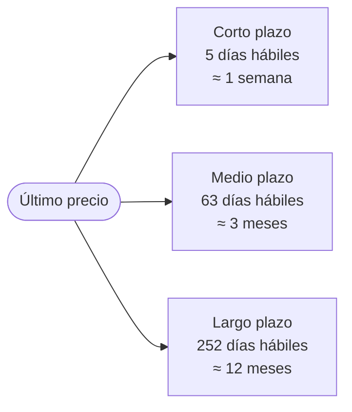
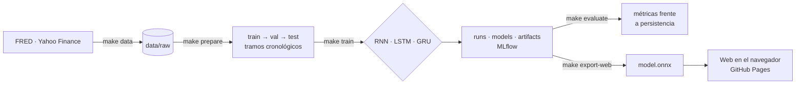
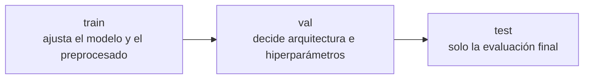

<div align="center">

# oil-rnn

**Predicción del precio del Brent con redes recurrentes, ejecutada en el navegador.**

[](https://alejandrobarreche.github.io/oil-rnn/)
[](docs/USAGE.md)
[](docs/references.bib)

[](https://github.com/alejandrobarreche/oil-rnn/actions/workflows/ci.yml)

</div>

---

## Contenido

1. [Qué hace](#qué-hace)
2. [Cómo funciona](#cómo-funciona)
3. [Decisiones de diseño](#decisiones-de-diseño)
4. [Resultados](#resultados)
5. [Inicio rápido](#inicio-rápido)
6. [Tecnologías](#tecnologías)
7. [Estructura](#estructura)
8. [Estado del proyecto](#estado-del-proyecto)

---

## Qué hace

Entrena una RNN simple, una LSTM y una GRU con la serie diaria del Brent (desde 2000) y variables de mercado. Cada modelo se compara con la referencia trivial de persistencia: «el precio futuro es el de hoy». El mejor modelo se exporta a ONNX y la página web lo ejecuta en el navegador, sin servidor y sin enviar datos.

Se predicen tres horizontes a partir del último precio conocido:



---

## Cómo funciona

**Figura 1. Del dato a la web**



**Figura 2. División cronológica de los datos**



---

## Decisiones de diseño

- **Splits cronológicos, sin mezclar fechas.** El modelo nunca entrena con datos posteriores a los que predice.
- **Preprocesado ajustado solo con train.** La media y la escala de val y test no influyen en el entrenamiento.
- **`test` solo en la evaluación final.** Ninguna decisión se toma mirando test.
- **Cada métrica junto a su referencia de persistencia.** Un modelo que no mejora «el último valor conocido» no aporta nada.
- **Un run por entrenamiento, con id propio.** Fecha, nombre y ordenador identifican la configuración, el commit, el hash de los datos y los pesos.
- **Inferencia en el navegador.** La web es estática: no hay servidor que mantener y los datos no salen del equipo.

---

## Resultados

> [!NOTE]
> Aún no hay runs definitivos. Esta sección se rellenará solo con métricas medidas sobre `test`, para cada red y cada horizonte: MAE, RMSE, mejora frente a persistencia, número de parámetros y tiempo de entrenamiento.

- **RNN:** pendiente
- **LSTM:** pendiente
- **GRU:** pendiente

---

## Inicio rápido

```bash
make setup
conda activate oil-rnn
make data
make prepare
make train NAME=baseline
make web-dev
```

`make prepare` se detiene si `configs/config.yaml` tiene valores `PENDIENTE`; `make pending` los lista. Todos los comandos, agrupados por fase y por tarea, están en la [guía de uso](docs/USAGE.md). `make help` los resume en la terminal.

---

## Tecnologías

<div align="center">


</div>

---

## Estructura

<details>
<summary>Carpetas principales</summary>

```text
oil-rnn/
├── configs/config.yaml     configuración; cada run guarda su copia
├── data/                   no se versiona: raw/, train/, val/, test/, splits.json
├── runs/<run_id>/          config, meta, métricas y log del run
├── artifacts/<run_id>/     gráficas y predicciones
├── models/<run_id>/        pesos y preprocesado (no se versiona)
├── notebooks/              exploración con train
├── src/oil_rnn/            datos, features, modelo, métricas, runs, exportación
├── web/                    aplicación web (Vite + TypeScript)
├── docs/                   USAGE.md · enunciado · bibliografía · presentación
├── tests/
└── Makefile
```

</details>

---

## Estado del proyecto

- [x] Estructura inicial y descarga de datos
- [ ] Decisiones de `config.yaml` (target, variables, ventana, horizonte, splits)
- [ ] Entrenamiento y comparación de RNN, LSTM y GRU
- [ ] Modelo exportado y web publicada

---

## Bibliografía

`docs/references.bib` es la única fuente de citas y se mantiene con Zotero (Better BibTeX).
