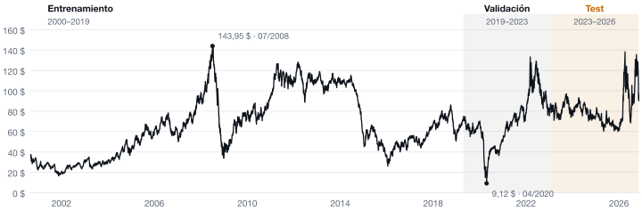
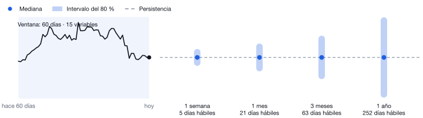
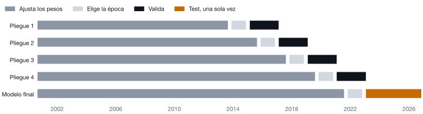
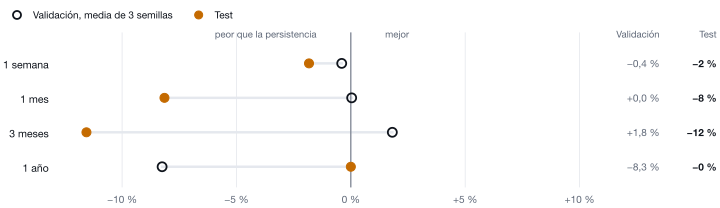
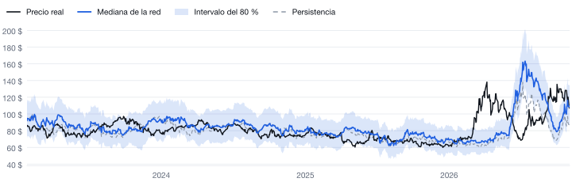

<div align="center">

# oil-rnn

**Predicción del precio del Brent con redes neuronales recurrentes.**

[](https://alejandrobarreche.github.io/oil-rnn/)
[](docs/USAGE.md)
[](docs/DECISIONES.md)
[](docs/references.bib)

[](https://github.com/alejandrobarreche/oil-rnn/actions/workflows/ci.yml)

</div>

<picture>
  <source media="(prefers-color-scheme: dark)" srcset="docs/img/history-dark.svg">
  
</picture>

Una RNN simple, una LSTM y una GRU predicen el Brent a **1 semana, 1 mes, 3 meses y 1 año**. Cada una se compara con la referencia más simple: **el precio de hoy**, la persistencia. El modelo elegido se ejecuta en el navegador, sin servidor.

## Qué predice

<picture>
  <source media="(prefers-color-scheme: dark)" srcset="docs/img/forecast-dark.svg">
  
</picture>

La red lee los últimos 60 días de 15 variables de mercado (20 en el modelo de 1 semana) y da, para cada horizonte, la mediana y un intervalo del 80 %. Hay un modelo por horizonte.

<sub>Esquema: el tamaño de los intervalos es ilustrativo.</sub>

## Cómo se valida

<picture>
  <source media="(prefers-color-scheme: dark)" srcset="docs/img/walk-forward-dark.svg">
  
</picture>

Cada pliegue entrena con todo lo anterior y valida los 2 años siguientes. Entre tramos quedan `h` días sin usar, para que ningún dato de entrenamiento mire al futuro. Test se usa una sola vez, al final.

## Resultado

<picture>
  <source media="(prefers-color-scheme: dark)" srcset="docs/img/skill-dark.svg">
  
</picture>

**Prometedor en validación, no se confirma en test.** En 2023–2026 ninguna red supera a la persistencia. Quedan por detrás un 1,8 % a 1 semana, un 8,1 % a 1 mes y un 11,6 % a 3 meses; a 1 año la validación descarta la red y el modelo es la propia persistencia. Ninguna diferencia es significativa al 5 %: la red no la mejora, pero tampoco se puede afirmar que sea peor.

<picture>
  <source media="(prefers-color-scheme: dark)" srcset="docs/img/test-h63-dark.svg">
  
</picture>

<sub>3 meses (GRU, media de 5 semillas, predicción contraída al 60 %) en test: aún exagera los movimientos, la mitad que sin contraer.</sub>

## Inicio rápido

```bash
make setup
conda activate oil-rnn
make data
make prepare
make cv NAME=<nombre>
make train NAME=<nombre> CALIB=<run_id de make cv>
make update
make web-dev
```

- **Datos al día**: `make update` descarga las series hasta hoy y rehace la entrada de la web sin reentrenar; el navegador pasa los datos nuevos por las redes ya entrenadas. Un workflow de GitHub Actions lo ejecuta cada día y vuelve a publicar la web.

- **`make pending`**: lista los valores `PENDIENTE` de `configs/config.yaml`; los comandos que los usan se detienen.
- **Todos los comandos**: en la [guía de uso](docs/USAGE.md). `make help` los resume.

## Detalles técnicos

<details>
<summary><b>Selección de modelos</b>: rejilla y validación walk-forward</summary>

- **Rejilla**: 36 configuraciones (tamaño oculto 32–256, 1 o 2 capas, dropout 0 o 0,3, tasa de aprendizaje 1e‑4 a 1e‑3) para las tres celdas y los cuatro horizontes: 432 validaciones walk-forward.
- **Criterio**: a 1 semana y 1 mes, la red con menor pérdida pinball media en 3 semillas; a 3 meses y 1 año, la de menor RMSE con contracción (rejilla g2, abajo).
- **3 meses y 1 año (rejilla g2)**: las redes de la rejilla anterior exageraban el movimiento. Se repitió la búsqueda con redes de 16 a 64 unidades, ventana de 20 días y la media de 5 semillas, y se contrae el rendimiento predicho hacia la persistencia: rendimiento × w, con w ∈ [0, 1] elegido en validación (w = 0 es la persistencia). La w de cada pliegue sale solo de los anteriores. Criterio: RMSE de validación con la contracción.
- **1 semana**: una GRU de 16 unidades (rejilla aparte de redes pequeñas, ventana de 20 días) empata con la de 256 dentro de la variación entre semillas y se elige por coste: 125 veces menos parámetros.
- **Test**: la elección se fijó antes de evaluar en test. A 3 meses y 1 año, test se evaluó dos veces: primero con la rejilla anterior (−61 % y −45 %) y después con la g2, cuya regla de elección quedó en git antes de entrenar.
- **Mejora**: 1 − error de la red / error de la referencia. Positiva = la red es mejor.
- **Referencias**: persistencia para el RMSE; cuantiles históricos del rendimiento a `h` días en train para el pinball.

Mejor configuración de cada red, media ± desviación en 3 semillas. En negrita, la elegida.

| h | Red | Pinball | Mejora pinball | Mejora RMSE | Pliegues mejores que la persistencia |
|---|---|---|---|---|---|
| 5 | **GRU-16** | **0,853 ± 0,008** | +0,7 % ± 1,1 | −0,4 % ± 0,3 | 4 / 12 |
| 5 | GRU-256 | 0,847 ± 0,010 | +1,5 % ± 1,1 | −1,1 % ± 0,9 | 2 / 12 |
| 5 | RNN | 0,848 ± 0,006 | +1,3 % ± 0,6 | −0,7 % ± 0,6 | 4 / 12 |
| 5 | LSTM | 0,852 ± 0,016 | +0,6 % ± 2,0 | −2,0 % ± 2,1 | 2 / 12 |
| 21 | **LSTM** | **1,832 ± 0,018** | +0,5 % ± 0,8 | +0,0 % ± 1,0 | 8 / 12 |
| 21 | RNN | 1,849 ± 0,018 | −0,5 % ± 1,1 | −3,2 % ± 0,1 | 3 / 12 |
| 21 | GRU | 1,871 ± 0,050 | −1,5 % ± 2,5 | −4,0 % ± 2,6 | 4 / 12 |
| 63 | **GRU** | **3,170 ± 0,096** | +2,6 % ± 2,2 | +4,8 % ± 0,6 | 9 / 12 |
| 63 | RNN | 3,232 ± 0,047 | +2,2 % ± 1,3 | +1,4 % ± 1,0 | 8 / 12 |
| 63 | LSTM | 3,282 ± 0,044 | +0,8 % ± 1,0 | +0,1 % ± 0,3 | 4 / 12 |
| 252 | **RNN** | **7,36 ± 0,65** | −2,3 % ± 7,3 | −4,3 % ± 3,4 | 6 / 12 |
| 252 | GRU | 7,60 ± 0,83 | −2,7 % ± 6,5 | −5,3 % ± 3,6 | 6 / 12 |
| 252 | LSTM | 7,85 ± 0,50 | −8,1 % ± 7,3 | −5,0 % ± 2,4 | 6 / 12 |

Rejilla g2 a 3 meses y 1 año: mejor configuración de cada red (media de 5 semillas). Mejora RMSE en los pliegues 2 a 4, con la w elegida solo con los pliegues anteriores. En negrita, la elegida.

| h | Red | Configuración | w final | Mejora RMSE con contracción | Mejora RMSE sin contracción |
|---|---|---|---|---|---|
| 63 | **GRU** | **64 · 2 capas · dropout 0,2 · lr 1e‑3** | **0,6** | **+3,1 %** | +1,8 % |
| 63 | LSTM | 32 · 2 capas · dropout 0,2 · lr 1e‑3 | 0,4 | +2,0 % | −0,8 % |
| 63 | RNN | 64 · 2 capas · dropout 0,2 · lr 3e‑4 | 0,4 | +0,9 % | +0,3 % |
| 252 | **RNN** | **16 · 1 capa · lr 1e‑3** | **0** | **0,0 %** | −8,3 % |
| 252 | GRU | 16 · 1 capa · lr 1e‑3 | 0 | 0,0 % | −8,2 % |
| 252 | LSTM | 16 · 1 capa · lr 1e‑3 | 0 | 0,0 % | −10,0 % |

A 1 año, w = 0 es la mejor en las 36 configuraciones: ninguna aporta información y todas empatan con la persistencia, así que la elección de la RNN es arbitraria.

</details>

<details>
<summary><b>Evaluación en test</b>: 955 días, 25/01/2023–03/11/2026</summary>

- **Modelos**: entrenados con train + val, semilla 42 (a 3 meses y 1 año, semillas 42 a 46).
- **Antes, a 3 meses y 1 año**: GRU-128 de 2 capas (155 523 parámetros), −61 %, y RNN-256 de 2 capas (202 499), −45 %.
- **Unidades**: precios en $/barril; tiempos en una RTX 3050 Ti Laptop, salvo el de 5 días, entrenado en un Mac.

| h | Red | Configuración | Parámetros | Entrenamiento | RMSE red / persistencia | Mejora RMSE | MAE red / persistencia | Mejora pinball | Cobertura 80 % (red / histórica) |
|---|---|---|---|---|---|---|---|---|---|
| 5 | GRU | 16 · 1 capa · ventana 20 · lr 1e‑4 | 1 683 | 66 s | 5,46 / 5,36 | −1,8 % | 3,73 / 3,62 | +0,0 % | 78 % / 79 % |
| 21 | LSTM | 64 · 1 capa · lr 1e‑4 | 21 187 | 11 s | 11,56 / 10,69 | −8,1 % | 7,42 / 7,00 | −6,7 % | 86 % / 84 % |
| 63 | GRU | 64 · 2 capas · dropout 0,2 · ventana 20 · lr 1e‑3 · 5 semillas · w 0,6 | 204 495 (5 × 40 899) | 22 s | 19,57 / 17,54 | −11,6 % | 12,93 / 11,44 | −7,5 % | 83 % / 86 % |
| 252 | RNN | 16 · 1 capa · ventana 20 · lr 1e‑3 · 5 semillas · w 0 | 2 975 (5 × 595) | 25 s | 22,71 / 22,71 | 0,0 % | 16,72 / 16,72 | −0,7 % | 97 % / 92 % |

</details>

<details>
<summary><b>MSE y R²</b> frente a la persistencia (<code>python -m oil_rnn.explore fit</code>)</summary>

- **R² del precio**: 1 − MSE / varianza del precio real en test. Mide cuánto de la variación del precio explica la predicción.
- **R² del rendimiento**: lo mismo sobre log(precio real / último precio conocido), el cambio a h días que la red intenta predecir. La persistencia predice siempre 0, así que su R² es ≤ 0.

| h | Red | MSE red / persistencia ($²) | R² del precio red / persistencia | R² del rendimiento red / persistencia |
|---|---|---|---|---|
| 5 | GRU | 29,8 / 28,7 | 0,86 / 0,86 | −0,05 / −0,00 |
| 21 | LSTM | 133,6 / 114,2 | 0,36 / 0,45 | −0,11 / −0,01 |
| 63 | GRU | 383 / 308 | −0,83 / −0,47 | −0,09 / −0,01 |
| 252 | RNN | 516 / 516 | −1,47 / −1,47 | −0,02 / −0,02 |

- **El R² del precio engaña solo**: el 0,86 a 5 días es el mismo que el de la persistencia. Lo explica el precio de hoy, no la red.
- **R² del rendimiento negativo en los cuatro horizontes**: ninguna red explica el cambio de precio mejor que predecir la media de test. A 1 año coincide con el de la persistencia porque el modelo es la persistencia.

</details>

<details>
<summary><b>Cuándo acierta y cuándo falla</b>: mejora del RMSE por año</summary>

Año de la fecha predicha; 2026 llega hasta el 03/11. Positiva = la red tiene menos error que la persistencia.

| h | Red | 2023 | 2024 | 2025 | 2026 |
|---|---|---|---|---|---|
| 5 | GRU | −1,9 % | −8,7 % | −0,2 % | −1,2 % |
| 21 | LSTM | −5,8 % | +4,0 % | −12,7 % | −9,0 % |
| 63 | GRU | −3,4 % | −10,9 % | −28,6 % | −11,6 % |
| 252 | RNN | 0,0 % | 0,0 % | 0,0 % | 0,0 % |

- **5 días**: queda pegada a la persistencia todos los años; el peor es 2024.
- **21 días**: solo mejora en 2024, el año de menor volatilidad de test (27 % anual, frente a 31–34 % en 2023 y 2025 y 70 % en 2026).
- **63 días**: pierde todos los años, aunque mucho menos que la red anterior (−58 % a −93 %). El peor es 2025.
- **252 días**: el modelo es la persistencia, así que su error es el mismo cada año.

</details>

<details>
<summary><b>Contraste de Diebold-Mariano</b> frente a la persistencia (<code>make dm</code>)</summary>

- **H0**: la red y la persistencia tienen el mismo error esperado. Estadístico > 0 = la red tiene más error.
- **Método**: Diebold y Mariano (1995) con la corrección de Harvey, Leybourne y Newbold (1997). La varianza suma las autocovarianzas hasta el retardo h − 1, porque los pronósticos a h días se solapan, y el estadístico se compara con una t de n − 1 grados de libertad.

| h | Red | Pronósticos (independientes ≈ n/h) | Error cuadrático: estadístico · p | Error absoluto: estadístico · p |
|---|---|---|---|---|
| 5 | GRU | 955 (191) | +1,00 · 0,32 | +1,86 · 0,063 |
| 21 | LSTM | 955 (45) | +0,73 · 0,46 | +0,74 · 0,46 |
| 63 | GRU | 955 (15) | +0,85 · 0,39 | +1,33 · 0,18 |
| 252 | RNN | 955 (3) | — | — |

A 252 días la predicción es la de la persistencia (difieren en menos de 10⁻⁶ $), así que no hay nada que contrastar.

</details>

<details>
<summary><b>Conclusión por horizonte</b></summary>

- **5 días**: la GRU-16 queda un 1,8 % por detrás de la persistencia en RMSE (p = 0,32). Su intervalo cubre el 78 % de los casos, tan bien como los cuantiles históricos, no mejor. En validación no se distinguían ni las tres celdas ni la GRU de 16 frente a la de 256: la diferencia de pinball era menor que la variación entre semillas.
- **5 días, retraso de publicación**: la EIA publica el spot con retraso, y el futuro del Brent ya se conoce. Actualizar el último spot con lo que se ha movido el futuro mejora a la persistencia en validación un 8,5 % con 1 día y un 31 % con 3 (`make naive-futures`). Buena parte de la dificultad a 5 días es ese retraso, no la red.
- **21 días**: sin mejora ni en validación ni en test.
- **63 días**: la red anterior predecía de media una subida del 11 % en test, cuando la real fue del 1,7 % (−61 %). Con redes pequeñas, 5 semillas y la predicción contraída al 60 %, la subida media prevista baja al 5,3 % y el error a −11,6 %. Acierta el signo el 53 % de los días, frente al 44 % de la dirección más frecuente en train.
- **252 días**: en validación ninguna red mejora a la persistencia y la contracción elige w = 0. El modelo publicado da el precio de hoy, con el intervalo de la red. Cada bloque de 2 años tiene unos 2 pronósticos independientes, así que la muestra no permite estimar bien el error.
- **Significación**: el −11,6 % a 63 días tiene p = 0,39, porque test tiene unos 15 pronósticos independientes a 63 días. A 63 y 252 días el contraste tiene poca potencia: «no significativo» no quiere decir «igual».
- **2026**: la cobertura del intervalo cae al 62 % a 5 días, al 52 % a 21 y al 32 % a 63, cuando el precio sube un 16 % a 63 días y un 30 % a 252. A 252 días cubre el 86 %.
- **Aplicación**: muestra el modelo elegido en cada horizonte, con el aviso de que en 2023–2026 no mejora a «el precio de hoy». El dato más fiable es el intervalo a 5 días.

</details>

---

<div align="center">


<sub>Citas: Diebold y Mariano (1995), <i>Comparing Predictive Accuracy</i>; Harvey, Leybourne y Newbold (1997), <i>Testing the equality of prediction mean squared errors</i>. Fuente única: <a href="docs/references.bib"><code>docs/references.bib</code></a>.</sub>

</div>
