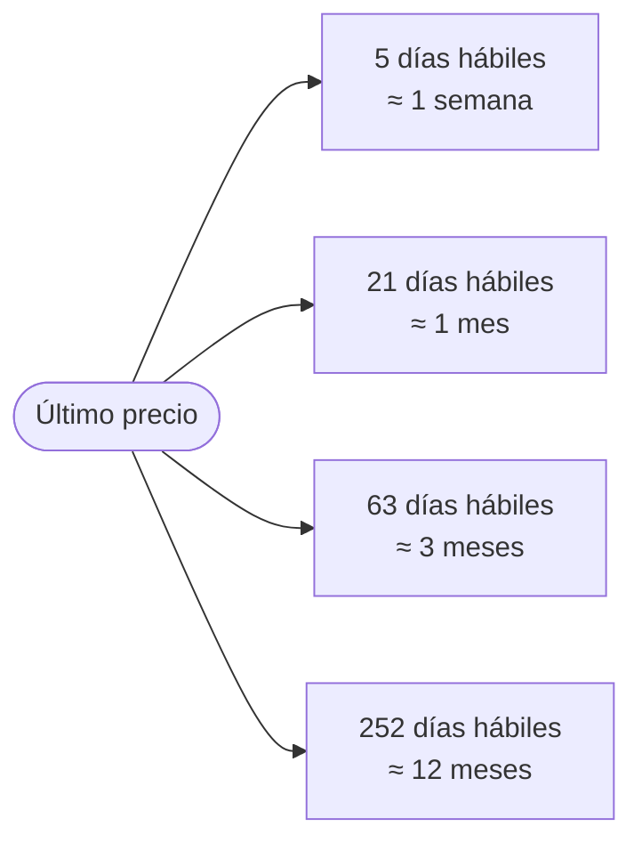
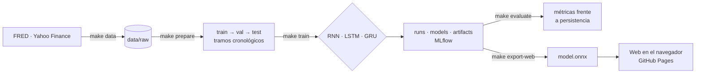
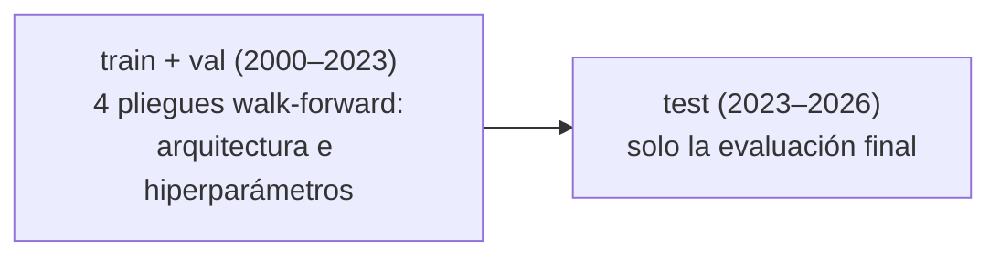
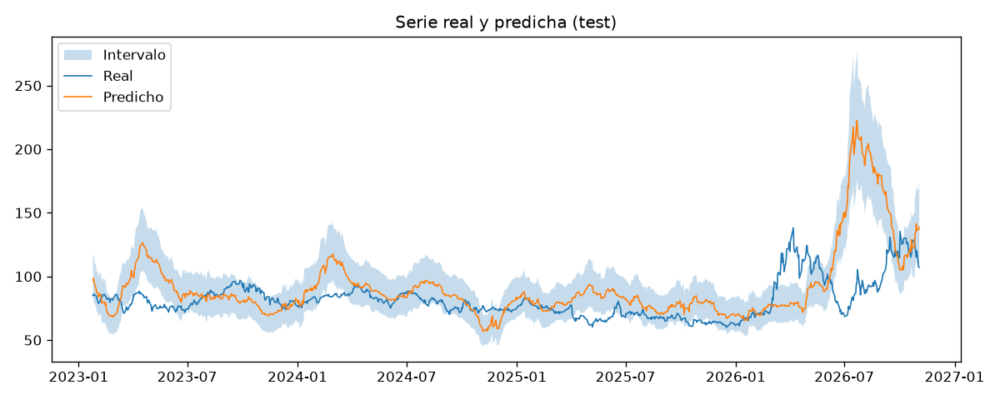

<div align="center">

# oil-rnn

**Predicción del precio del Brent con redes recurrentes, ejecutada en el navegador.**

[](https://alejandrobarreche.github.io/oil-rnn/)
[](docs/USAGE.md)
[](docs/references.bib)

[](https://github.com/alejandrobarreche/oil-rnn/actions/workflows/ci.yml)

</div>

---

## Contenido

1. [Qué hace](#qué-hace)
2. [Cómo funciona](#cómo-funciona)
3. [Decisiones de diseño](#decisiones-de-diseño)
4. [Resultados](#resultados)
5. [Inicio rápido](#inicio-rápido)
6. [Tecnologías](#tecnologías)
7. [Estructura](#estructura)
8. [Estado del proyecto](#estado-del-proyecto)

---

## Qué hace

Entrena una RNN simple, una LSTM y una GRU con la serie diaria del Brent (desde 2000) y variables de mercado. Cada modelo se compara con la referencia trivial de persistencia: «el precio futuro es el de hoy». El mejor modelo se exporta a ONNX y la página web lo ejecuta en el navegador, sin servidor y sin enviar datos.

Se predicen cuatro horizontes a partir del último precio conocido, con un modelo por horizonte. Cada modelo da la mediana y un intervalo del 80 % (cuantiles 0,1 y 0,9, calibrados con calibración conforme):



---

## Cómo funciona

**Figura 1. Del dato a la web**



**Figura 2. División cronológica de los datos**



Cada pliegue entrena con todo lo anterior a un bloque de 2 años (2015–2023) y predice ese bloque. Entre el entrenamiento y el bloque se dejan `horizonte` filas sin usar, para que ningún objetivo de entrenamiento sea posterior al momento de la predicción.

---

## Decisiones de diseño

- **Splits cronológicos, sin mezclar fechas.** El modelo nunca entrena con datos posteriores a los que predice.
- **Preprocesado ajustado solo con train.** La media y la escala de val y test no influyen en el entrenamiento.
- **`test` solo en la evaluación final.** Ninguna decisión se toma mirando test.
- **Cada métrica junto a su referencia de persistencia.** Un modelo que no mejora «el último valor conocido» no aporta nada.
- **Un run por entrenamiento, con id propio.** Fecha, nombre y ordenador identifican la configuración, el commit, el hash de los datos y los pesos.
- **Inferencia en el navegador.** La web es estática: no hay servidor que mantener y los datos no salen del equipo.

---

## Resultados

> [!IMPORTANT]
> **En test (25/01/2023–03/11/2026), ninguna red supera a la persistencia en ningún horizonte.** La única mejora que se veía en validación (GRU a 63 días, +4,8 %) no se confirma: en test es un 61 % peor. A 5 días el intervalo del 80 % está bien calibrado (cobertura del 78 %), pero no es mejor que el de los cuantiles históricos.

**Cómo se eligió cada modelo.** Rejilla de 36 configuraciones (tamaño oculto 32–256, 1 o 2 capas, dropout 0 o 0,3, tasa de aprendizaje 1e‑4 a 1e‑3), igual para las tres celdas y los cuatro horizontes: 432 validaciones walk-forward. En cada horizonte se eligió la red con menor pérdida pinball media en 3 semillas. La elección quedó registrada en `docs/PLAN.md` antes de evaluar en test, y test se evaluó una sola vez.

**Tabla 1. Validación walk-forward (4 pliegues, 2015–2023): mejor configuración de cada red, media ± desviación en 3 semillas**

Mejora = 1 − error de la red / error de la referencia; > 0 significa que la red es mejor. Referencia del RMSE: persistencia. Referencia del pinball: cuantiles históricos del rendimiento a `h` días en train. En negrita, la red elegida.

| h | Red | Pinball | Mejora pinball | Mejora RMSE | Pliegues mejores que la persistencia |
|---|---|---|---|---|---|
| 5 | **GRU** | **0,847 ± 0,010** | +1,5 % ± 1,1 | −1,1 % ± 0,9 | 2 / 12 |
| 5 | RNN | 0,848 ± 0,006 | +1,3 % ± 0,6 | −0,7 % ± 0,6 | 4 / 12 |
| 5 | LSTM | 0,852 ± 0,016 | +0,6 % ± 2,0 | −2,0 % ± 2,1 | 2 / 12 |
| 21 | **LSTM** | **1,832 ± 0,018** | +0,5 % ± 0,8 | +0,0 % ± 1,0 | 8 / 12 |
| 21 | RNN | 1,849 ± 0,018 | −0,5 % ± 1,1 | −3,2 % ± 0,1 | 3 / 12 |
| 21 | GRU | 1,871 ± 0,050 | −1,5 % ± 2,5 | −4,0 % ± 2,6 | 4 / 12 |
| 63 | **GRU** | **3,170 ± 0,096** | +2,6 % ± 2,2 | +4,8 % ± 0,6 | 9 / 12 |
| 63 | RNN | 3,232 ± 0,047 | +2,2 % ± 1,3 | +1,4 % ± 1,0 | 8 / 12 |
| 63 | LSTM | 3,282 ± 0,044 | +0,8 % ± 1,0 | +0,1 % ± 0,3 | 4 / 12 |
| 252 | **RNN** | **7,36 ± 0,65** | −2,3 % ± 7,3 | −4,3 % ± 3,4 | 6 / 12 |
| 252 | GRU | 7,60 ± 0,83 | −2,7 % ± 6,5 | −5,3 % ± 3,6 | 6 / 12 |
| 252 | LSTM | 7,85 ± 0,50 | −8,1 % ± 7,3 | −5,0 % ± 2,4 | 6 / 12 |

**Tabla 2. Evaluación final en test (955 días, 2023–2026)**

Modelos entrenados con train + val, semilla 42. Precios en $/barril.

| h | Red | Configuración | Parámetros | Entrenamiento | RMSE red / persistencia | Mejora RMSE | MAE red / persistencia | Mejora pinball | Cobertura 80 % (red / histórica) |
|---|---|---|---|---|---|---|---|---|---|
| 5 | GRU | 256 · 1 capa · lr 1e‑3 | 211 203 | 17 s | 5,55 / 5,36 | −3,6 % | 3,73 / 3,62 | −1,4 % | 78 % / 79 % |
| 21 | LSTM | 64 · 1 capa · lr 1e‑4 | 21 187 | 11 s | 11,56 / 10,69 | −8,1 % | 7,42 / 7,00 | −6,7 % | 86 % / 84 % |
| 63 | GRU | 128 · 2 capas · dropout 0,3 · lr 1e‑4 | 155 523 | 29 s | 28,24 / 17,54 | −61 % | 16,94 / 11,44 | −39 % | 68 % / 86 % |
| 252 | RNN | 256 · 2 capas · dropout 0,3 · lr 1e‑4 | 202 499 | 10 s | 33,03 / 22,71 | −45 % | 23,62 / 16,72 | −34 % | 92 % / 92 % |

Tiempos medidos en una RTX 3050 Ti Laptop.

**Figura 3. GRU a 63 días en test: precio real, mediana prevista e intervalo del 80 %**



**Conclusión por horizonte**

- **5 días.** La red queda a un 3,6 % de la persistencia en RMSE. Su intervalo cubre el 78 % de los casos, cerca del 80 % nominal, pero es tan bueno como el de los cuantiles históricos, no mejor. En validación las tres celdas no se distinguían: la diferencia de pinball era menor que la variación entre semillas.
- **21 días.** Sin mejora ni en validación ni en test.
- **63 días.** En validación mejoraba a la persistencia en las 3 semillas, pero la mejora venía sobre todo del pliegue 2021–2023 (+21 %). En test la red predice de media una subida del 11 % a 63 días, cuando la real fue del 1,7 %, y amplifica los movimientos recientes (Figura 3). La dirección sí lleva algo de información: acierta el signo del cambio en el 60 % de los días y la correlación entre el rendimiento previsto y el real es de 0,27. Lo que falla es la magnitud.
- **252 días.** Peor que la persistencia en validación y en test. Cada bloque de 2 años contiene unos 2 pronósticos independientes a 252 días, así que la muestra no permite estimar bien el error.
- **2026.** En los tres horizontes cortos la cobertura del intervalo cae al 48–58 % en 2026, cuando el precio sube un 16 % a 63 días y un 30 % a 252.

**Qué muestra la aplicación.** El modelo elegido en cada horizonte, junto con el aviso de que, medido en 2023–2026, no mejora a «el precio de hoy». El dato más fiable es el intervalo a 5 días.

---

## Inicio rápido

```bash
make setup
conda activate oil-rnn
make data
make prepare
make train NAME=baseline
make web-dev
```

`make prepare` se detiene si `configs/config.yaml` tiene valores `PENDIENTE`; `make pending` los lista. Todos los comandos, agrupados por fase y por tarea, están en la [guía de uso](docs/USAGE.md). `make help` los resume en la terminal.

---

## Tecnologías

<div align="center">


</div>

---

## Estructura

<details>
<summary>Carpetas principales</summary>

```text
oil-rnn/
├── configs/config.yaml     configuración; cada run guarda su copia
├── data/                   no se versiona: raw/, train/, val/, test/, splits.json
├── runs/<run_id>/          config, meta, métricas y log del run
├── artifacts/<run_id>/     gráficas y predicciones
├── models/<run_id>/        pesos y preprocesado (no se versiona)
├── notebooks/              exploración con train
├── src/oil_rnn/            datos, features, modelo, métricas, runs, exportación
├── web/                    aplicación web (Vite + TypeScript)
├── docs/                   USAGE.md · enunciado · bibliografía · presentación
├── tests/
└── Makefile
```

</details>

---

## Estado del proyecto

- [x] Estructura inicial y descarga de datos
- [x] Decisiones de `config.yaml` (target, variables, ventana, horizonte, splits)
- [x] Comparación de RNN, LSTM y GRU en validación walk-forward (432 runs + 3 semillas)
- [x] Evaluación final en test
- [x] Modelos exportados y aplicación publicada (Sonda, primera versión)
- [ ] Rediseño de la aplicación
- [ ] Página explicativa
- [ ] Actualización de datos y reentrenamiento periódicos

---

## Bibliografía

`docs/references.bib` es la única fuente de citas y se mantiene con Zotero (Better BibTeX).
